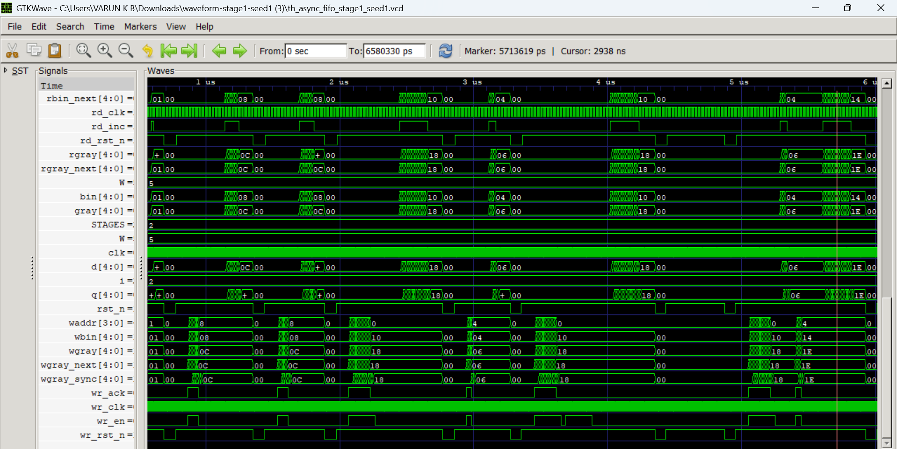
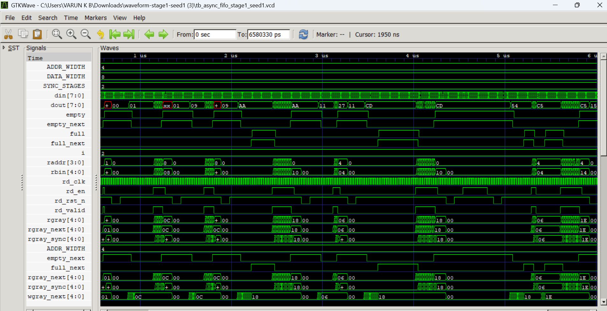

# Async_FIFO_CDC: parameterizable asynchronous FIFO with SystemVerilog verification

Dual-clock FIFO (Gray-coded pointers, 2-flop synchronizers) plus a procedural SystemVerilog verification
environment: independent reference-queue scoreboard, pointer/protocol assertions, directed + randomized tests,
functional event-bin coverage and a scripted regression.

> **Status: simulated and passing.** The full regression (38 tests) passes in **GitHub Actions with Icarus Verilog**
> for seeds 1, 2 and 3, and the author's local **Vivado 2026.1 XSim** run reported the same 38/38. Assertions are
> procedural checkers, not native SVA. Logs are in `reports/ci_logs/`; waveforms are in `waveforms/`.

## Results

> **Update pending CI confirmation:** three directed tests (T59-T61) and coverage exclusions were added **after** the
> runs reported below, to close the reachable cross bins. The tables in this section are the **38-test baseline**; the
> numbers for the 41-test regression will be added from the next CI run.

### GitHub Actions baseline (Icarus Verilog, `+STAGE=0`, 38 tests, before T59-T61)
| Item | seed 1 | seed 2 | seed 3 |
|---|---|---|---|
| Tests passed / failed | 38 / 0 | 38 / 0 | 38 / 0 |
| Scoreboard errors | 0 | 0 | 0 |
| Assertion (procedural check) failures | 0 | 0 | 0 |
| Total checks | 112,380 | 117,627 | 111,670 |
| Writes / reads compared | 20,008 / 19,867 | 20,707 / 20,552 | 20,054 / 19,912 |
| Functional EVENT bins | 39 / 39 | 39 / 39 | 39 / 39 |
| Functional CROSS bins | 23 / 32 | 23 / 32 | 23 / 32 |
| Final | PASS | PASS | PASS |

Source: `reports/ci_logs/sim_seed{1,2,3}.log`; seed-1 extracts in `reports/simulation_summary.txt`,
`reports/assertion_summary.txt` (183,960 procedural check evaluations) and `reports/functional_coverage.txt`.

### Author's local Vivado 2026.1 XSim run (earlier reference, log not committed)
38 / 38 tests, 0 scoreboard errors, 0 assertion failures, 112,332 checks (260 testbench + 112,072 scoreboard),
20,159 writes / 20,035 reads compared, EVENT 39 / 39, CROSS 25 / 32, 183,527 procedural check evaluations.
Counts differ slightly from CI because random streams differ between simulators.

### Coverage notes
In the 38-test baseline EVENT bins are 100% covered and CROSS coverage is 23 / 32. The 9 missed bins (all seeds, listed
in `reports/functional_coverage.txt`) are classified in [docs/verification_plan.md](docs/verification_plan.md): 3 are
unreachable by construction and are now **excluded** in the coverage report (marked `EXCL`; reachable total 29), and 6
are targeted by the new directed tests T59 (blocked write at occupancy 0 / low), T60 (reset at empty) and T61 (reset at
full). **Whether these tests hit their bins is not yet confirmed**; the target is 29 / 29 reachable (29 / 32 raw) and the
number will only be quoted from a real CI log. Event-bin coverage is hand-written functional coverage, not RTL code
coverage and not formal CDC proof.

### Waveforms (GTKWave, stage 1 run, seed 1)
Captured in GTKWave from the CI waveform [`waveforms/tb_async_fifo_stage1_seed1.vcd`](waveforms/tb_async_fifo_stage1_seed1.vcd)
(stage 1 = tests T1-T10, 0 to 6.58 us). Open the `.vcd` in GTKWave to inspect any signal. The reset pulses between
tests are the testbench's system resets.


*Binary and Gray pointers. Every accepted write (`wr_ack`) or read (`rd_inc`) moves the Gray pointer by one bit, and
`wgray_sync` follows `wgray` a couple of clocks later because it passes through the synchronizer.*


*`wr_we` pulses store `din` at `waddr`; `dout` shows the word at `raddr` (first-word fall-through). The red `xx` values
are locations that have not been written yet; `dout` is a don't-care while the FIFO is empty.*


*`empty` is high after reset and drops once a write has crossed the synchronizer; `full` asserts when the FIFO fills
and clears after reads. Each flag follows its `_next` signal by one clock because the flags are registered.*

## Why an asynchronous FIFO
A producer and a consumer on unrelated clocks cannot share a binary counter safely. Only Gray-coded pointers
(one bit changes per step) go through synchronizers, so a sampled pointer is always a valid old-or-new value.

## Layout
```
rtl/            async_fifo, fifo_memory, write_pointer, read_pointer, gray_encoder, synchronizer, full_empty_logic
verification/   tb_async_fifo (top), scoreboard, assertions, coverage, tests/ (basic, boundary, cdc, reset, random)
scripts/        run.sh, run_stage1-3.sh, run_all.sh, check_model.sh
docs/           architecture.md, verification_plan.md, model/fifo_model.py (Python algorithm model, not RTL)
reports/        simulation / assertion / coverage summaries and ci_logs/ (real CI output)
waveforms/      stage-1 VCD from CI and GTKWave screenshots
.github/workflows/regression.yml
```
Design details, interface timing (combinational first-word-fall-through `dout`), flag equations and the reset
protocol are in [docs/architecture.md](docs/architecture.md); the test matrix and coverage analysis are in
[docs/verification_plan.md](docs/verification_plan.md).

## Verification architecture
```
 random / directed drivers --> async_fifo (wr_clk, rd_clk independent) --> dout, full, empty, wr_ack, rd_valid
        |                                   |                                   |
        |                         assertions (pointer, Gray,                scoreboard (reference model:
        |                         synchronizer, reset checks;               accepted writes in, accepted reads
        |                         procedural, uses DUT pointers)            compared; never uses DUT pointers)
        +--> coverage (event bins + cross bins) <---------------------------------+
```
- **Scoreboard:** independent reference of accepted writes; each accepted read is compared with the oldest unread word.
  Write and read monitors own separate counters and use time stamps, so coincident clock edges are handled
  deterministically. It also checks flag correctness (`full` at maximum occupancy, `empty` at zero) and that a stale flag
  clears within `SYNC_STAGES+1` edges.
- **Assertions:** procedural checkers (not native SVA) for no write when full / read when empty, pointer step and hold,
  Gray one-bit change, reset values, synchronizer latency and memory-write protection.
- **Coverage:** hand-written functional event bins (39) and cross bins (32), reported separately.

## Tests (38 passing in CI; T59-T61 added, pending run)
| Group | Tests |
|---|---|
| Basic | T1-T10: reset, single/multiple write and read, full, empty, write while full, read while empty, recovery |
| Boundary | T16, T18, T20: max/min occupancy, repeated fill/drain (pointer wrap), full/empty boundaries |
| Clocks and CDC | T21, T23, T24, T26, T36, T37, T38: concurrent traffic, clock ratios, phase shift |
| Sync latency / near boundary | T27, T28, T29, T31, T32, T33 |
| Reset | T44-T49: reset during write, read, simultaneous traffic, full, empty; recovery |
| Random | T51, T54, T55, T56, T57, T58: random traffic, clock ratios, resets, long stress, boundaries |
| Cross-bin closure (new, not yet run) | T59: blocked write while `full` is stale (occupancy 0 / low); T60: reset at empty with write+read active; T61: reset at full with write+read active |

## Run
```
bash scripts/run_stage1.sh      # basic tests
bash scripts/run_stage2.sh      # boundary + clock ratio/phase tests
bash scripts/run_stage3.sh      # reset + randomized tests
bash scripts/run_all.sh         # stages 1,2,3 + combined run; writes reports/*.txt; nonzero exit on ANY failure
SEED=7 WAVES=1 bash scripts/run_all.sh iverilog      # WAVES=1 writes waveforms/tb_async_fifo.vcd; or: bash scripts/run_all.sh riviera
```
Run from the repo root. Icarus Verilog needs `-g2012` support for queues and SystemVerilog tasks (version 12
recommended). With Icarus the assertions are **procedural checkers, not native SVA**; Riviera-PRO/XSim uses real SVA
(`+define+USE_SVA`). The CI log step "Show simulator version" records the Icarus version.

## Continuous integration (GitHub Actions)
Workflow: `.github/workflows/regression.yml` (Icarus Verilog on `ubuntu-24.04`).
- **Triggers:** every push / pull request to `main` or `master`, and manually (Actions tab -> *Async FIFO CDC
  regression* -> *Run workflow*).
- **Job `regression`:** matrix over seeds 1, 2, 3. Each seed compiles with `iverilog -g2012`, runs `tb_async_fifo`
  with all stages, and fails if the compiler or simulator returns non-zero, the log has no `FINAL: PASS`, any
  failed test / scoreboard error / assertion failure is reported, or the requested seed is missing from the log.
  Artifacts: `sim-logs-seed-1|2|3` (compile + simulation logs, model sanity log).
- **Job `waveform`:** runs stage 1 with `+vcd` and uploads `waveform-stage1-seed1` (`.vcd`, open with GTKWave).
- The workflow calls the tools directly (no shell-script permission dependence). Logs/waveforms are uploaded even when
  a step fails (`if: always()`).
- The testbench writes a VCD only when `+vcd` is given, so Vivado/XSim runs no longer try to open a relative path.
- Download artifacts from the run summary page (bottom, *Artifacts*): `sim-logs-seed-N` and `waveform-stage1-seed1`.

## Implemented vs verified
| Item | Written | Run / result |
|---|---|---|
| RTL (7 modules; `gray_decoder` omitted, not needed) | yes | simulated: Vivado XSim, Icarus (CI) |
| Scoreboard, procedural checkers, coverage bins | yes | 0 errors, 0 failures; EVENT 39/39, CROSS 23/32 (CI) |
| 38 tests (matrix in docs/verification_plan.md) | yes | 38/38 PASS, seeds 1-3 (CI) |
| T59-T61 cross-bin closure tests, `EXCL` bins in coverage report | yes | not yet run |
| Synchronizer-latency checks/tests (T31-T33) | yes | PASS |
| GitHub Actions workflow | yes | green for seeds 1, 2, 3 and waveform job |
| T50, negative tests, bug injection | no | pending |
| Native SVA mode (`+define+USE_SVA`) | yes | not run |
| UVM, formal, static CDC, synthesis | no | not done |

## Limitations
- Single-domain reset is unsupported (system reset only).
- Simulation cannot prove metastability safety; no static CDC or formal analysis was done.
- Scoreboard cannot tell loss from reordering from corruption; it reports a data mismatch.
- `dout` uses an asynchronous memory read (LUT-RAM/register-file style); no block-RAM mapping (see architecture.md).
- Reset is applied at fixed offsets, not randomly near clock edges (T50 pending).
- CROSS coverage was 23 / 32 in the last CI run; 3 missed bins are unreachable by construction (now excluded) and 6 are targeted by T59-T61 (result pending)
  (see docs/verification_plan.md).
- Native-SVA mode exists but has not been run; CI uses Icarus with procedural checkers.

## Future work
Confirm T59-T61 close the 6 reachable cross bins (written, not yet run); reset near clock edges
(T50); negative tests and bug injection; a native-SVA run in Riviera-PRO/XSim; static CDC and formal checks;
a block-RAM variant with a registered-read interface.
